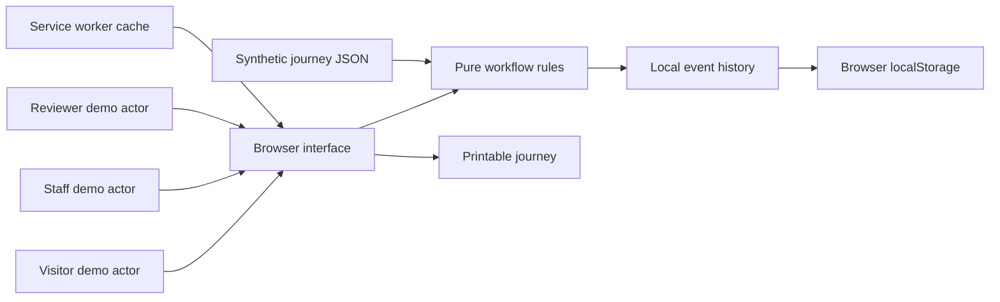

# Technical design

## Scope

A dependency-free JavaScript application with an accessible text-first UI, pure domain rules and a static local server. This implements a smaller alternative to the React/TypeScript architecture proposed in the research report to minimize setup and deadline risk. Persistence uses localStorage, not IndexedDB. There is no production backend.

## State transitions

`report → blocked → claim → pending → recheck(pass) → clear`

`pending → recheck(fail) → blocked`

`clear → observation expiry → stale`

Missing evidence is unknown. A known barrier does not disappear when time passes. An ordinary clear observation cannot bypass a barrier's repair/recheck sequence. The claiming demo actor cannot verify the claim. These are domain invariants only; switching actors is possible for anyone using the demo.

Journey priority is blocked, pending, unknown, stale, then clear. All required segments must have current clear observations before the aggregate is clear. Even this status means only that the recorded observations have no known obstruction; it is not universal accessibility or safety certification.

## Interfaces

`createState(dataset, now)`, `segmentStatus(segment, now)`, `journeyStatus(journey, state, now)`, `applyAction(state, action, now)`. State mutations clone their input; tests use an injected clock. Local event replay uses the same action validation as live interactions.

## Offline and update behavior

The service worker installs a versioned cache of application files. Same-origin GET requests use the network and fall back to that cache when offline. First use requires a network/local server connection. HTTP responses such as a live 404 are not silently replaced with cached success. Increment the cache version when changing assets; close/reopen old tabs to activate a waiting worker. Time-sensitive observations continue expiring offline.

## Deployment boundary

For a real pilot, add authenticated staff/reviewer accounts, server-side authorization, authoritative timestamps, audit storage and conflict-aware sync. Define observation validity periods with beneficiaries and staff. Add a staffed escalation process. Never call the local actor switch secure authorization.
