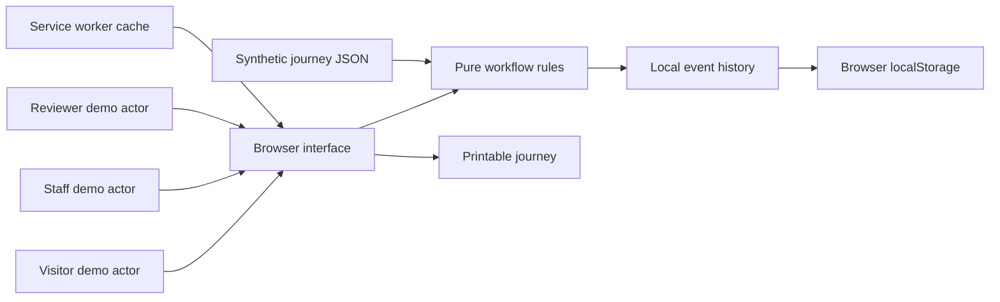
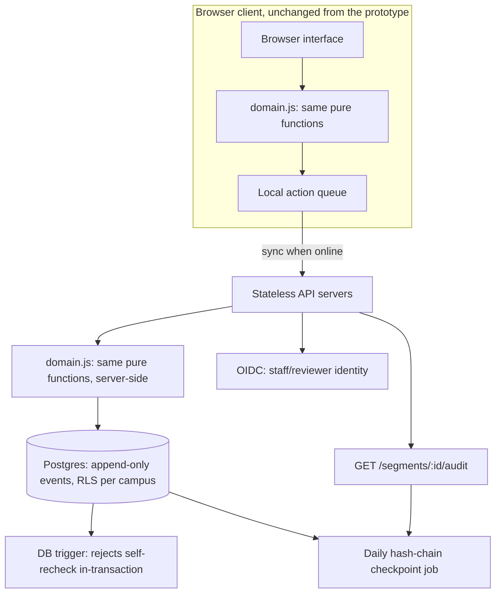

# Technical design

## Scope

A dependency-free JavaScript application with an accessible text-first UI, pure domain rules and a static local server. This implements a smaller alternative to the React/TypeScript architecture proposed in the research report to minimize setup and deadline risk. Persistence uses localStorage, not IndexedDB. There is no production backend.

## State transitions

`report → blocked → claim → pending → recheck(pass) → clear`

`pending → recheck(fail) → blocked`

`clear → observation expiry → stale`

Missing evidence is unknown. A known barrier does not disappear when time passes. An ordinary clear observation cannot bypass a barrier's repair/recheck sequence. The claiming demo actor cannot verify the claim. These are domain invariants only; switching actors is possible for anyone using the demo.

Journey priority is blocked, pending, unknown, stale, then clear. All required segments must have current clear observations before the aggregate is clear. Even this status means only that the recorded observations have no known obstruction; it is not universal accessibility or safety certification.

## Interfaces

`createState(dataset, now)`, `segmentStatus(segment, now)`, `journeyStatus(journey, state, now)`, `applyAction(state, action, now)`. State mutations clone their input; tests use an injected clock. Local event replay uses the same action validation as live interactions.

## Offline and update behavior

The service worker installs a versioned cache of application files. Same-origin GET requests use the network and fall back to that cache when offline. First use requires a network/local server connection. HTTP responses such as a live 404 are not silently replaced with cached success. Increment the cache version when changing assets; close/reopen old tabs to activate a waiting worker. Time-sensitive observations continue expiring offline.

## Deployment boundary

For a real pilot, add authenticated staff/reviewer accounts, server-side authorization, authoritative timestamps, audit storage and conflict-aware sync. Define observation validity periods with beneficiaries and staff. Add a staffed escalation process. Never call the local actor switch secure authorization.

## Production system design (reference design, not implemented)

This is the design we'd build toward for a real pilot. None of it runs today; the prototype is deliberately client-only. It's written here because the decision that matters most, enforcing the relay rule on a server instead of trusting a browser, is a data-layer and auth decision, not a new feature, and we wanted to show we'd thought it through before claiming the idea works.

**Why the core logic ports with no rewrite.** `domain.js` has zero DOM or browser globals: every function is `(state, action, now) → state`. That was an accessibility decision first (no framework weight, no third-party JS to break screen readers) but it has a second payoff: the same pure functions that run in the browser today (`applyAction`, `segmentStatus`, `auditTrail`) can run unmodified inside an API server. The business logic isn't something we'd port later, it already is the portable part.

**Data model.** One append-only `events` table is the source of truth, mirroring the `state.events` log the prototype already keeps client-side:

| Column | Notes |
|---|---|
| `event_id` | ULID, sortable by creation time |
| `campus_id` | tenant boundary, see below |
| `segment_id` | references `segments` |
| `type` | report / claim / recheck / observe |
| `actor_id` | references `identities`, never a free-text string |
| `passed` | nullable boolean, recheck only |
| `occurred_at` | server-stamped, not client-stamped |
| `prev_hash` | hash of the previous event for this segment, see tamper evidence below |

`segments`, `journeys` and `identities` are plain reference tables. Current status is never stored directly, it's always `segmentStatus(replayEvents(segment_id), now)`, computed from the event log exactly like the client does today. That keeps the server's notion of "current state" mathematically identical to the client's, instead of two implementations drifting apart.

**Enforcing the relay rule at the data layer, not just the UI.** The client-side check (`isSelfRecheckAttempt`) is a UX courtesy; someone could call the API directly and skip it. The real guarantee has to live in the write path:
- A `claim` write requires a JWT whose role claims include `staff` or `reviewer`, scoped to that campus.
- A `recheck` write is rejected in the same transaction that would insert it unless `actor_id != (the most recent unresolved claim's actor_id)`, enforced with a Postgres `CHECK` via a `BEFORE INSERT` trigger, not application code, so a bug in the API layer can't silently create a self-verified repair.
- Every insert is append-only. `UPDATE`/`DELETE` on `events` is revoked from the application's database role entirely.

**Tamper evidence.** Each event stores a hash of the previous event for that segment (a per-segment hash chain). A daily job anchors the day's final hash per campus into a separate, even-more-restricted `checkpoints` table. `GET /segments/:id/audit` replays the chain and verifies it before returning, so a direct database edit (not just an API bypass) would be detectable, not just inconvenient. This is the same shape as the prototype's `auditTrail()` export, the server version just also proves nobody tampered with the rows it's grouping.

**API surface (REST, versioned under `/v1`).**
- `GET /journeys/:id/status` — current journey + segment status, computed from the event log at request time
- `POST /segments/:id/report` — visitor role, rate-limited per IP since reporters aren't authenticated
- `POST /segments/:id/claim` — staff role required
- `POST /segments/:id/recheck` — reviewer role required, rejected server-side if same actor as the open claim
- `GET /segments/:id/audit` — signed, hash-verified event history
- `GET /campus/:id/priority` — server-side `campusPriority`, same algorithm as the client, over live data

**Identity.** OIDC against the institution's existing staff directory (most campuses already run one), not a new password system. Visitors reporting a barrier stay anonymous; a `report` write needs no identity, only a rate limit, since requiring an account would directly undercut the "anyone can report, no app required" goal that also motivates the SMS bridge.

**Offline-first sync.** Segments are often exactly where connectivity is worst (a ramp, a lift). The client queues actions locally (it already does, via the existing `localStorage` event log), tags each with a client-generated idempotency key, and replays the queue against the API when back online. The server is the only source of truth for ordering; a queued action that's since been superseded (someone else already rechecked it) fails cleanly with a reason the UI can show, rather than silently overwriting.

**Multi-tenancy and scale.** `campus_id` on every table, Postgres row-level security scoped to it, so one institution's data is structurally unreachable from another's connection, not just filtered in application code. The event table partitions by `(campus_id, month)`; stale-observation sweeps and escalation-reminder jobs run per partition so one large campus can't slow down another's queries. Stateless API servers behind a load balancer, Postgres with a read replica for the status/priority endpoints that get hit on every page load.

**What stays exactly as it is.** The UI, the state machine, the four core invariants (no self-verification, barriers don't expire, claims aren't closure, clear observations go stale) don't change at all moving from prototype to pilot. That's the point of keeping the domain layer pure and dependency-free from day one: the backend is additive infrastructure around an already-correct core, not a rewrite of it.

