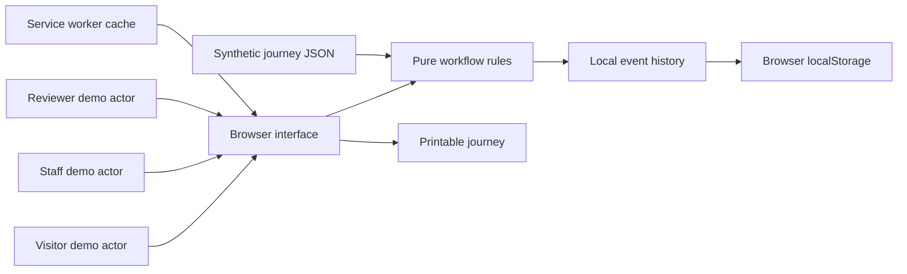
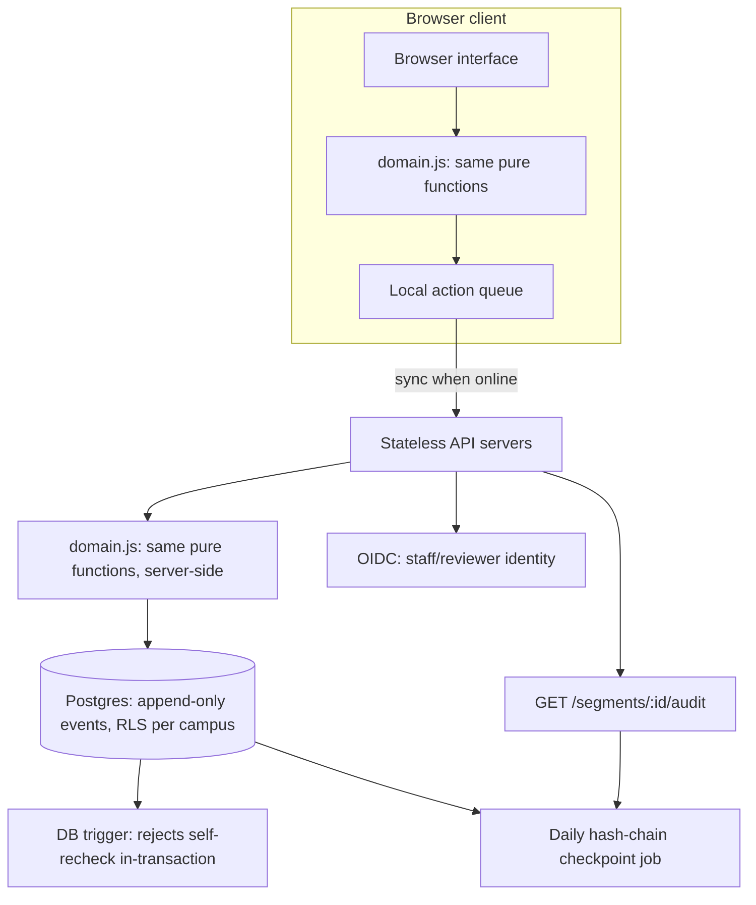

# Technical design

## Scope

A dependency-free JavaScript application with an accessible text-first UI, pure domain rules and a static local server. This implements a smaller alternative to the React/TypeScript architecture proposed in the research report to minimize setup and deadline risk. Persistence uses localStorage, not IndexedDB. There is no production backend.

## State transitions

`report → blocked → claim → pending → recheck(pass) → clear`

`pending → recheck(fail) → blocked`

`clear → observation expiry → stale`

Missing evidence is unknown. A known barrier does not disappear when time passes. An ordinary clear observation cannot bypass a barrier's repair/recheck sequence. The claiming demo actor cannot verify the claim. These are domain invariants only; switching actors is possible for anyone using the demo.

Journey priority is blocked, pending, unknown, stale, then clear. All required segments must have current clear observations before the aggregate is clear. Even this status means only that the recorded observations have no known obstruction; it is not universal accessibility or safety certification.

## Interfaces

`createState(dataset, now)`, `segmentStatus(segment, now)`, `journeyStatus(journey, state, now)`, `applyAction(state, action, now)`. State mutations clone their input; tests use an injected clock. Local event replay uses the same action validation as live interactions.

## Offline and update behavior

The service worker installs a versioned cache of application files. Same-origin GET requests use the network and fall back to that cache when offline. First use requires a network/local server connection. HTTP responses such as a live 404 are not silently replaced with cached success. Increment the cache version when changing assets; close/reopen old tabs to activate a waiting worker. Time-sensitive observations continue expiring offline.

## Deployment boundary

For a real pilot, add authenticated staff/reviewer accounts, server-side authorization, authoritative timestamps, audit storage and conflict-aware sync. Define observation validity periods with beneficiaries and staff. Add a staffed escalation process. Never call the local actor switch secure authorization.

## Production system design (reference design, not implemented)

This is the design we'd build toward for a real pilot. None of it runs today; the prototype is deliberately client-only. It's written here because the decision that matters most, enforcing the relay rule on a server instead of trusting a browser, is a data-layer and auth decision, not a new feature, and we wanted to show we'd thought it through before claiming the idea works.

**Why the core logic is reusable.** `domain.js` has no DOM dependencies: its workflow functions accept state, an action and an injected time. That makes the rules suitable for reuse in server-side JavaScript after adding authenticated identity, persistence and request validation. The reference backend below does not exist in this repository, and deploying it would still require integration and security work.

**Data model.** One append-only `events` table is the source of truth, mirroring the `state.events` log the prototype already keeps client-side:

| Column | Notes |
|---|---|
| `event_id` | ULID, sortable by creation time |
| `campus_id` | tenant boundary, see below |
| `segment_id` | references `segments` |
| `type` | report / claim / recheck / observe |
| `actor_id` | references `identities`, never a free-text string |
| `passed` | nullable boolean, recheck only |
| `occurred_at` | server-stamped, not client-stamped |
| `prev_hash` | hash of the previous event for this segment, see tamper evidence below |

`segments`, `journeys` and `identities` are reference tables. A future server would replay accepted events and calculate current status using the same tested rules as the prototype, rather than maintaining a second independent status implementation.

**Enforcing the relay rule at the data layer, not just the UI.** The prototype rejects invalid rechecks in `applyAction`, but its actor selector is not authentication. A production guarantee has to live in the authenticated write path:
- A `claim` write requires a JWT whose role claims include `staff` or `reviewer`, scoped to that campus.
- A `recheck` write is rejected in the insertion transaction unless `actor_id` differs from the most recent unresolved claim's actor. A database trigger or stored procedure would enforce this invariant independently of the API layer.
- Every insert is append-only. `UPDATE`/`DELETE` on `events` is revoked from the application's database role entirely.

**Tamper evidence.** The proposed design stores a hash of the previous event for each segment and anchors daily final hashes in a restricted checkpoint table. A future audit endpoint could verify that chain before returning it. The prototype's `auditTrail()` export only groups mutable browser-local events; it provides a convenient history, not cryptographic proof.

**API surface (REST, versioned under `/v1`).**
- `GET /journeys/:id/status` — current journey + segment status, computed from the event log at request time
- `POST /segments/:id/report` — visitor role, rate-limited per IP since reporters aren't authenticated
- `POST /segments/:id/claim` — staff role required
- `POST /segments/:id/recheck` — reviewer role required, rejected server-side if same actor as the open claim
- `GET /segments/:id/audit` — signed, hash-verified event history
- `GET /campus/:id/priority` — server-side `campusPriority`, same algorithm as the client, over live data

**Identity.** A pilot could use OIDC against an institution's existing staff directory instead of creating another password system. Visitors could report without a staff identity, subject to abuse controls defined with the institution.

**Offline-first sync.** The current prototype stores and replays actions only in one browser; it does not synchronize them. A pilot could add an explicit offline queue with idempotency keys and submit it when connectivity returns. The server would remain the source of truth and reject actions superseded by newer evidence.

**Multi-tenancy and scale.** `campus_id` on every table, Postgres row-level security scoped to it, so one institution's data is structurally unreachable from another's connection, not just filtered in application code. The event table partitions by `(campus_id, month)`; stale-observation sweeps and escalation-reminder jobs run per partition so one large campus can't slow down another's queries. Stateless API servers behind a load balancer, Postgres with a read replica for the status/priority endpoints that get hit on every page load.

**What the design preserves.** A pilot should preserve the four tested invariants: no self-verification, barriers do not disappear with age, claims are not closure, and clear observations become stale. Authentication, synchronization, authorization and audit integrity still require production implementation and validation.

